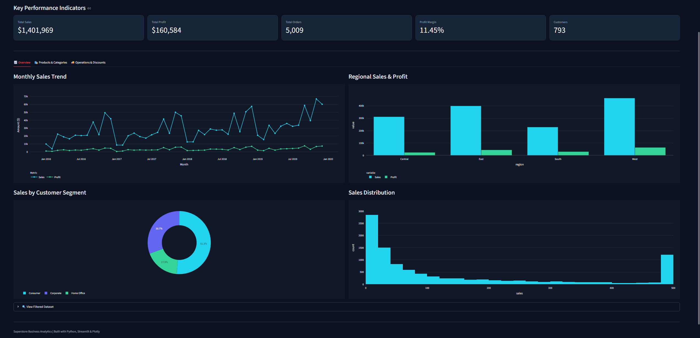
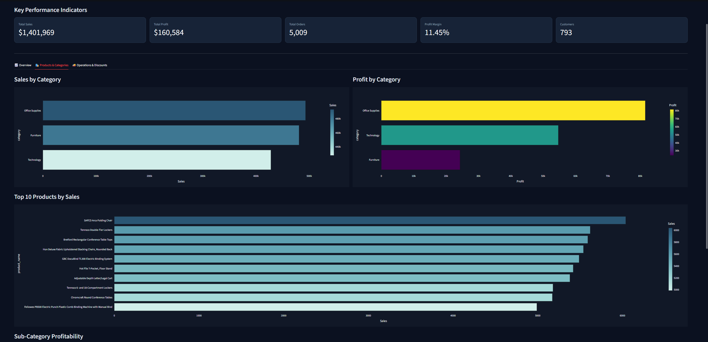
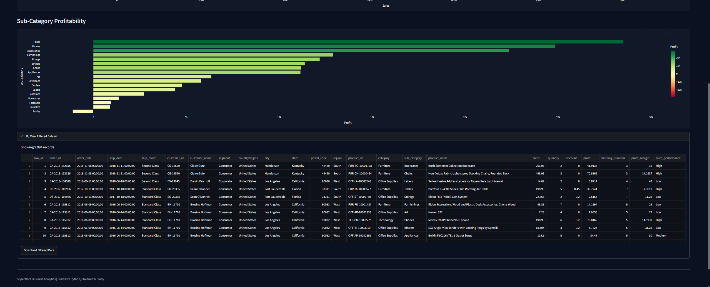
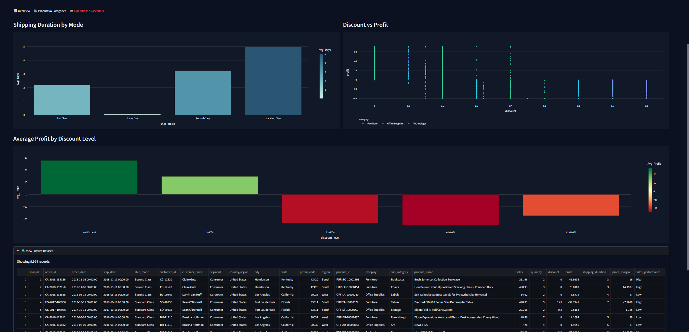

<div align="center">

# Superstore Business Analytics Dashboard

**An interactive business intelligence dashboard for exploring sales, profitability, products, customers, and operational performance.**

[](https://superstore-business-analytics.streamlit.app/)
[](https://www.python.org/)
[](https://streamlit.io/)
[](https://plotly.com/)

[**Open Live Dashboard →**](https://superstore-business-analytics.streamlit.app/)

</div>

---

## 📌 Project Overview

The **Superstore Business Analytics Dashboard** is an interactive analytics application built to explore retail transaction data and turn it into useful business insights.

It provides a consolidated view of sales, profit, customer segments, product performance, regional results, shipping operations, and the impact of discounts. Users can navigate between analytical sections, explore interactive visualizations, inspect filtered records, and download the filtered dataset.

The dashboard is designed to support data-driven decisions by making business performance easier to understand.

## 🚀 Live Demo

Explore the deployed application:

👉 **[Superstore Business Analytics – Streamlit App](https://superstore-business-analytics.streamlit.app/)**

## 📊 Key Performance Indicators

The dashboard displays the following headline metrics:

| KPI | Value |
|---|---:|
| Total Sales | **$1,401,969** |
| Total Profit | **$160,584** |
| Total Orders | **5,009** |
| Profit Margin | **11.45%** |
| Customers | **793** |

*These figures represent the dashboard's displayed overall metrics. Interactive filters can change the results shown in the app.*

---

## 🖥️ Dashboard Preview

### 1. Overview

The overview section provides a high-level picture of business performance through monthly sales and profit trends, regional comparisons, customer segment contribution, and sales distribution.



### 2. Products & Categories

Explore category-level sales and profit performance, compare product categories, and identify the top 10 products by sales.



### 3. Sub-Category Profitability

Compare profitability across product sub-categories and identify strong contributors as well as sub-categories generating losses. The section also provides a preview of the filtered records.



### 4. Operations & Discounts

Analyze shipping duration by shipping mode and investigate how discount levels relate to profitability, including average profit across discount ranges.



---

## ✨ Main Features

- **KPI Monitoring:** Track total sales, total profit, orders, profit margin, and customers.
- **Interactive Dashboard Sections:** Navigate between Overview, Products & Categories, and Operations & Discounts.
- **Sales Trend Analysis:** Explore monthly sales and profit performance over time.
- **Regional Performance:** Compare sales and profit across business regions.
- **Customer Segmentation:** Understand the contribution of Consumer, Corporate, and Home Office segments.
- **Product Analysis:** Identify top-selling products and compare category performance.
- **Profitability Analysis:** Evaluate profit by category and sub-category, including loss-making areas.
- **Shipping Analysis:** Compare average shipping duration across shipping modes.
- **Discount Analysis:** Examine the relationship between discounts and profit.
- **Filtered Data Preview:** Inspect records based on the selected filters.
- **CSV Export:** Download the filtered dataset for further analysis.

## 🔍 Business Questions Explored

The dashboard helps investigate questions such as:

1. How do sales and profit change over time?
2. Which regions contribute the most to sales and profit?
3. Which product categories generate the highest sales and profit?
4. Which products are the top contributors to sales?
5. Which sub-categories are the most and least profitable?
6. How do customer segments contribute to total sales?
7. Which shipping modes have the longest average delivery duration?
8. How do higher discount levels affect average profitability?

## 🛠️ Tech Stack

| Technology | Purpose |
|---|---|
| **Python** | Application logic and data analysis |
| **Pandas** | Data loading, preparation, filtering, and aggregation |
| **Streamlit** | Interactive dashboard and web application |
| **Plotly** | Interactive charts and visualizations |
| **Git & GitHub** | Version control and project hosting |
| **Streamlit Community Cloud** | Dashboard deployment |

---

## ⚙️ Run Locally

Follow these steps to run the dashboard on your machine.

### 1. Clone the repository

```bash
git clone https://github.com/THASO1/Superstore-Business-Analytics.git
cd Superstore-Business-Analytics
```

### 2. Create a virtual environment

```bash
python -m venv .venv
```

Activate it on Windows:

```bash
.venv\Scripts\activate
```

On macOS or Linux:

```bash
source .venv/bin/activate
```

### 3. Install dependencies

```bash
pip install -r requirements.txt
```

If you do not have a `requirements.txt` file yet, install the main packages with:

```bash
pip install streamlit pandas plotly
```

### 4. Configure the dataset

Make sure the Superstore dataset is available in the location expected by the application. If you are running the project from a different directory, update the dataset path in the app configuration/code accordingly.

### 5. Run the dashboard

```bash
streamlit run app.py
```

Streamlit will start a local server. Open the local URL shown in your terminal, usually:

```text
http://localhost:8501
```

---

## 📁 Repository Structure

```text
Superstore-Business-Analytics/
│
├── assets/
│   └── screenshots/
│       ├── 01-overview.png
│       ├── 02-products-categories.png
│       ├── 03-subcategory-profitability.png
│       └── 04-operations-discounts.png
│
├── app.py
├── requirements.txt
└── README.md
```

*The structure above highlights the main application and README assets. Keep any additional project files and data folders already present in the repository.*

## 📈 Dataset

This project uses Superstore retail transaction data. The dashboard preview shows **9,994 records** and includes fields relating to:

- Orders and dates
- Customers and customer segments
- Geography and regions
- Products, categories, and sub-categories
- Sales, quantity, discounts, and profit
- Shipping modes and shipping duration

The dashboard also presents derived analytical fields such as profit margin and sales performance.

## 🎯 Skills Demonstrated

- Data analysis and business understanding
- KPI calculation and performance monitoring
- Data aggregation and transformation with Pandas
- Interactive dashboard development with Streamlit
- Data visualization and storytelling with Plotly
- Product, customer, regional, and operational analysis
- Deployment of a Python web application

## 👨‍💻 Author

**Ahmed Osama**

- GitHub: [@THASO1](https://github.com/THASO1)
- Project Repository: [Superstore Business Analytics](https://github.com/THASO1/Superstore-Business-Analytics)
- Live Dashboard: [Streamlit App](https://superstore-business-analytics.streamlit.app/)

---

<div align="center">

**If you find this project useful, feel free to ⭐ the repository.**

</div>
